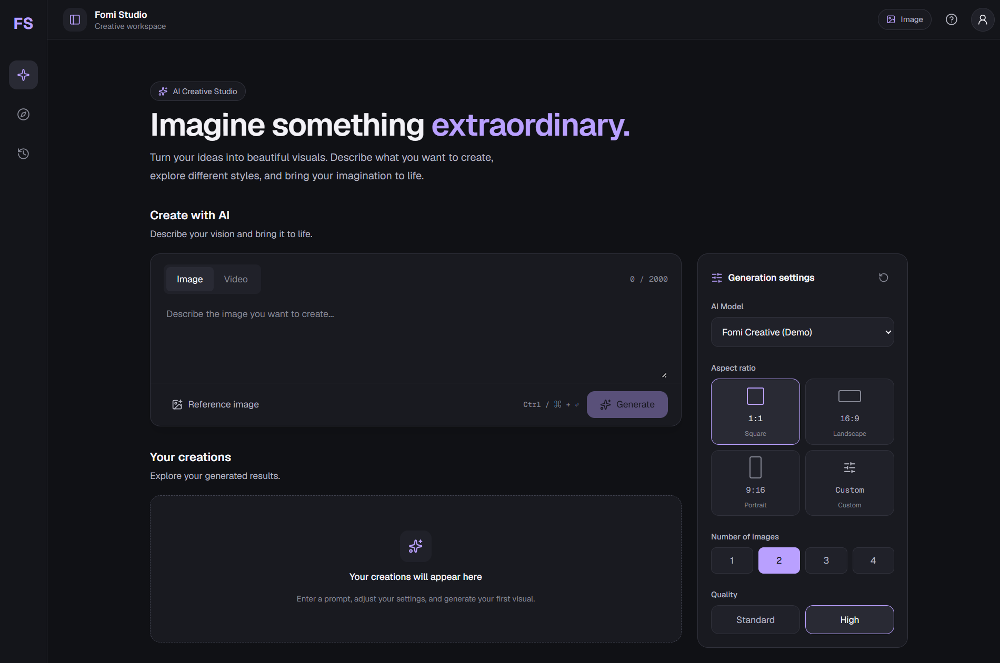
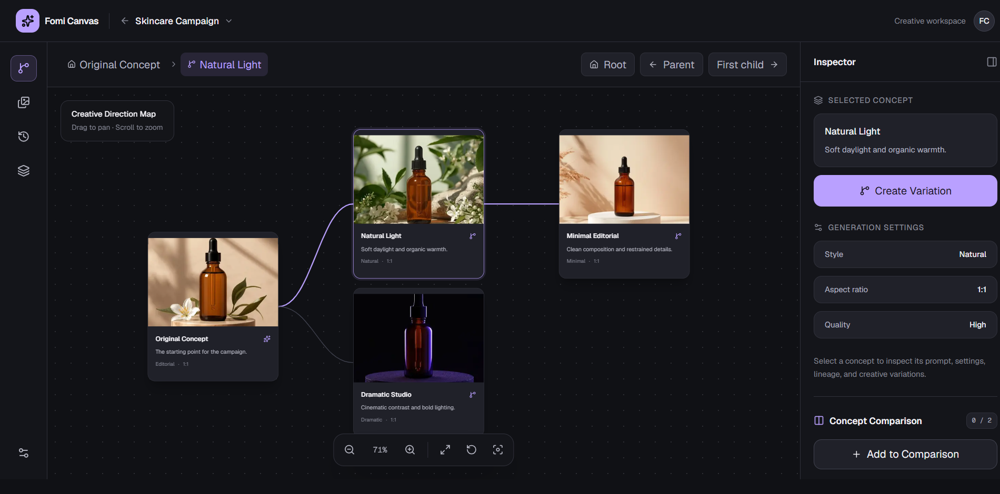

# Fomi Creative Suite

### Two Workspaces. One Vision for Creative AI.

A collection of two independent, responsive AI creative workspace experiences built with **Next.js, React, JavaScript, and Tailwind CSS** as part of the Fomi Frontend Developer Assessment.

**[Fomi Studio — Live Demo](https://fomi-studio-phi.vercel.app/)** · **[Fomi Canvas — Live Demo](https://fomi-canvas.vercel.app/)** · **[GitHub Repository](https://github.com/Sharjeel234/fomi-creative-suite)**

---

## Overview

**Fomi Creative Suite** is a monorepo containing two independent frontend applications developed for the Fomi Frontend Developer Assessment.

The project explores two complementary approaches to AI-powered creative software:

- **Fomi Studio — Part A:** A polished, responsive AI content generation interface based on the provided assessment mockups.
- **Fomi Canvas — Part B:** An original, spatial creative workspace designed around visual exploration, branching ideas, creative lineage, and side-by-side comparison.

Both applications emphasize usability, responsiveness, modular architecture, accessibility, and thoughtful interactions.

Rather than treating creative software as a collection of disconnected screens, the project focuses on making creative workflows intuitive, structured, and enjoyable.

> Both applications are frontend assessment implementations. Generation-related interactions use simulated data and demonstration assets rather than live AI inference.

## Applications

### 01 — Fomi Studio

**Part A: Product Implementation**

[](https://fomi-studio-phi.vercel.app/)

Fomi Studio transforms the supplied design references into a responsive, interactive AI generation workspace.

**Highlights**

- Responsive application shell with sidebar and topbar.
- Prompt composer and configurable generation settings.
- Aspect-ratio selection and custom-ratio controls.
- Mocked generation API.
- Image generation results gallery.
- Loading skeletons and empty states.
- Interactive image preview dialog.
- Keyboard navigation and focus management.
- Consistent dark-themed design system.

**Live Application:** https://fomi-studio-phi.vercel.app/

**Documentation:** [Fomi Studio README](./fomi-studio/README.md)

### 02 — Fomi Canvas

**Part B: Product Thinking Challenge**

[](https://fomi-canvas.vercel.app/)

Fomi Canvas explores a different vision for professional AI image creation.

Instead of presenting generated images as isolated results, it organizes creative exploration into a connected visual workspace.

Creators can explore variations, understand how concepts evolved, and compare alternative creative directions.

**Highlights**

- Interactive spatial canvas.
- Pan and zoom navigation.
- Concept nodes connected through parent-child relationships.
- Simulated branch generation.
- Contextual prompt and settings inheritance.
- Visual creative lineage.
- Branch history and navigation.
- Side-by-side concept comparison.
- Responsive workspace interactions.
- Keyboard-accessible dialogs.

**Live Application:** https://fomi-canvas.vercel.app/

**Documentation:** [Fomi Canvas README](./fomi-canvas/README.md)

## Design Philosophy

Both applications were developed around the assessment's guiding principles:

> Maximum capability. Minimum complexity.

> Every pixel should have a purpose.

> Design for professionals, not beginners.

> Beautiful software should feel effortless.

> The workspace is the hero.

These principles informed decisions about layout, visual hierarchy, interaction feedback, component structure, and workflow complexity.

### Shared Design Priorities

**Clarity over clutter**

Keep the most important creative actions visible without overwhelming the workspace.

**Meaningful interaction**

Use feedback, transitions, and interface states to help users understand what is happening.

**Professional visual language**

Apply consistent typography, spacing, surfaces, iconography, and interaction patterns.

**Scalable frontend architecture**

Separate responsibilities into reusable components, utilities, and focused state-management logic.

**Responsive by design**

Adapt interface composition to different viewport sizes rather than relying exclusively on scaled desktop layouts.

## Technology Stack

| Technology | Purpose |
|---|---|
| Next.js App Router | Application structure and routing |
| React | Component-driven interfaces |
| JavaScript | Application logic |
| Tailwind CSS | Responsive styling |
| CSS Custom Properties | Design tokens |
| Lucide React | Iconography |
| Geist / Geist Mono | Typography |
| Vercel | Application deployment |
| Git / GitHub | Version control |

Each application maintains its own source code and dependencies.

## Repository Structure

```text
fomi-creative-suite/
│
├── fomi-studio/
│   ├── app/
│   ├── components/
│   ├── public/
│   ├── package.json
│   └── README.md
│
├── fomi-canvas/
│   ├── app/
│   ├── components/
│   ├── public/
│   ├── package.json
│   └── README.md
│
├── assets/
│   └── ...
│
├── tokens/
│   └── ...
│
├── design-system.md
├── .gitignore
└── README.md
```

*Simplified conceptual structure; individual source directories may contain additional files and folders.*

## Getting Started

### Prerequisites

- Node.js compatible with the installed Next.js versions.
- npm.
- Git.

### Clone the repository

```bash
git clone https://github.com/Sharjeel234/fomi-creative-suite.git

cd fomi-creative-suite
```

### Run Fomi Studio

```bash
cd fomi-studio

npm install

npm run dev
```

Open http://localhost:3000.

### Run Fomi Canvas

From the repository root:

```bash
cd fomi-canvas

npm install

npm run dev
```

Open http://localhost:3000.

### Run both applications simultaneously

Because the applications are independent, they can be started on separate ports.

For example:

```bash
# Terminal 1
cd fomi-studio
npm run dev -- -p 3000
```

```bash
# Terminal 2
cd fomi-canvas
npm run dev -- -p 3001
```

Access:

- Fomi Studio: http://localhost:3000
- Fomi Canvas: http://localhost:3001

## Architecture

The monorepo separates the two assessment tasks into standalone applications.

**Fomi Studio**

Uses a traditional generation-workspace architecture, separating the application shell, prompt composer, generation settings, API interaction, and results gallery.

**Fomi Canvas**

Uses a spatial workspace architecture, separating concept data, canvas navigation, graph relationships, branching, lineage, and comparison workflows.

This separation allows each application to be developed, tested, and deployed independently.

## Engineering Focus

The implementations demonstrate:

- Reusable React components.
- Modular code organization.
- Responsive layouts.
- State-driven interactions.
- Clear loading and empty states.
- Accessible controls and dialogs.
- Frontend performance awareness.
- Maintainable JavaScript.
- Structured mock data and workflows.

## Assessment Scope

### Part A — Product Implementation

Recreate the supplied AI generation interface with close attention to visual fidelity, responsiveness, accessibility, interaction design, and code quality.

### Part B — Product Thinking Challenge

Propose an original professional creative workspace, demonstrate meaningful workflows, and explain the product and engineering decisions behind the experience.

Fomi Canvas was developed as the optional Part B submission.

## Current Limitations

These projects demonstrate frontend engineering and product thinking rather than production AI infrastructure.

- No live AI model inference.
- Generation workflows use mocked or simulated results.
- No production authentication or billing.
- No persistent cloud project storage.
- No real-time multi-user collaboration.

These features are outside the implemented assessment scope.

## Deployment

Both applications are deployed independently on Vercel.

| Application | Production URL |
|---|---|
| Fomi Studio | https://fomi-studio-phi.vercel.app/ |
| Fomi Canvas | https://fomi-canvas.vercel.app/ |

For independent deployment, configure the corresponding application directory as the Vercel project's root directory.

## Documentation

- [Fomi Studio — Technical Documentation](./fomi-studio/README.md)
- [Fomi Canvas — Product and Technical Documentation](./fomi-canvas/README.md)
- [Design System](./design-system.md)

## Author

**Sharjeel Mansoor**

Frontend / Full-Stack Developer

[GitHub](https://github.com/Sharjeel234)

---

**Disclaimer:** Fomi Creative Suite was created independently as a frontend developer assessment submission. It is not an official production release of Fomi.

**Built with a focus on thoughtful UX, frontend craftsmanship, and professional creative workflows.**